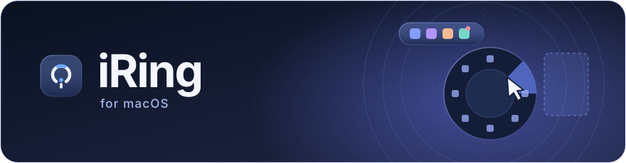

<div align="center">
  <h1></h1>
  <p><a href="README.md">简体中文</a> · <strong>English</strong></p>
  <p><strong>Switch apps, tile, and resize windows at your cursor.</strong><br />
  Hold left Option (⌥) to open the ring, then use your trackpad or mouse to arrange your workspace.</p>
  <p><a href="https://github.com/GitxHui/iRing/releases/download/v0.1.0-beta.2/iRing-v0.1.0-beta.2-macOS-arm64.dmg"><strong>Download for Mac (.dmg)</strong></a> · <a href="https://github.com/GitxHui/iRing/releases/tag/v0.1.0-beta.2">Beta 2 release notes</a><br />
  macOS 15+ · Apple silicon (arm64)</p>
</div>

<p align="center">
  
  <br /><sub>15-second interaction preview</sub>
</p>

## Three gestures to get started

| Do this | How |
| --- | --- |
| **Switch apps** | Hold left **⌥**, point toward an app in the ring, then release to switch. |
| **Tile a window** | While holding **⌥**, press **Tab** or tap the trackpad. Point to preview a half-screen, corner quarter, or maximized layout, then release to apply. |
| **Resize a window** | With the ring open, scroll with two fingers or the mouse wheel to adjust the selected window continuously from **45% to 100%**. Release to apply. |

## A Liquid Glass dock for your favorite apps

Place the dock around your MacBook notch or along any screen edge. Collapse it to a pill with unread indicators for supported apps, then expand it when you need it. Choose a Liquid Glass or black appearance and adjust the transparency and animation speed.

When you switch apps, iRing keeps windows on their current displays and leaves their sizes as they are by default. Optional settings let you maximize on switch or move the selected window to the dock's display.

<details>
<summary>Mouse and dock shortcuts</summary>

| Action | Default control |
| --- | --- |
| Open the app ring | Hold the middle mouse button and move the pointer. |
| Open the tiling ring | **⌥ + middle mouse button** |
| Show or hide the dock | **⌥ + Space** |
| Move the dock to the next display | **⌃ + ⌥ + →**, or drag it to another display. |

You can customize the mouse trigger, enable a dedicated tiling shortcut, and sort apps by when you added them or how often you use them. iRing supports English and Simplified Chinese.

</details>

## Install iRing

1. Open the [Beta 2 DMG](https://github.com/GitxHui/iRing/releases/download/v0.1.0-beta.2/iRing-v0.1.0-beta.2-macOS-arm64.dmg) and drag **iRing.app** into **Applications**.
2. Open iRing, then enable it in **System Settings → Privacy & Security → Accessibility**. Accessibility permission is sufficient for switching, tiling, and resizing.

The beta is ad hoc signed and has yet to be notarized by Apple. If macOS blocks the first launch, first check the download against the SHA-256 checksum on the [release page](https://github.com/GitxHui/iRing/releases/tag/v0.1.0-beta.2). For a verified copy, run the following command and reopen the app.

```bash
xattr -cr /Applications/iRing.app
```

The release page also provides a ZIP archive. Prebuilt packages target Apple silicon. Intel Mac users can try building from source.

## Build from source

Requires macOS 15+ and Swift 6.2+. Run these commands from the repository root.

```bash
swift run AIStageSelfTest
./Scripts/build_app.sh
./Scripts/release.sh
```

Use `SKIP_INSTALL=1 ./Scripts/build_app.sh` to build without installing into Applications.

[Changelog](CHANGELOG.md) · [MIT License](LICENSE) · [Report an issue](https://github.com/GitxHui/iRing/issues)
