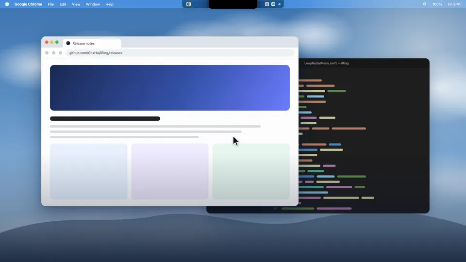
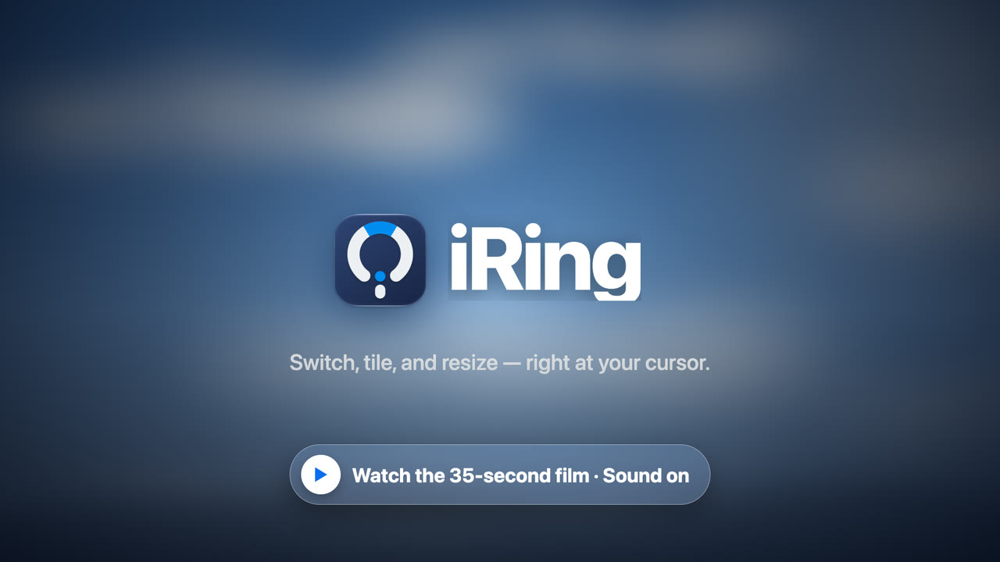
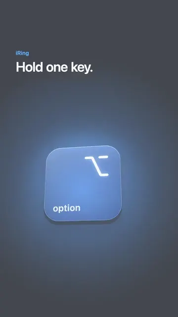
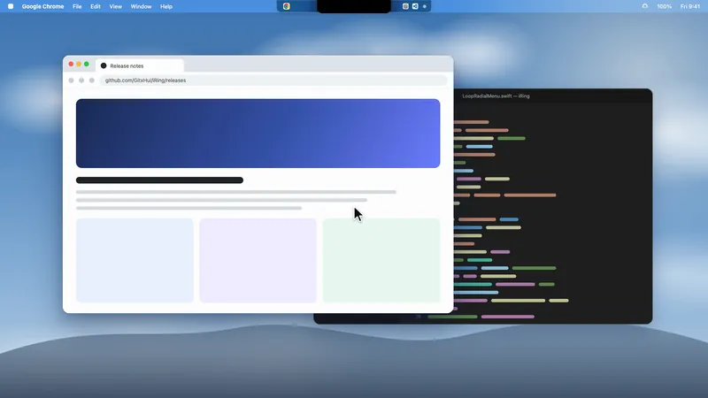
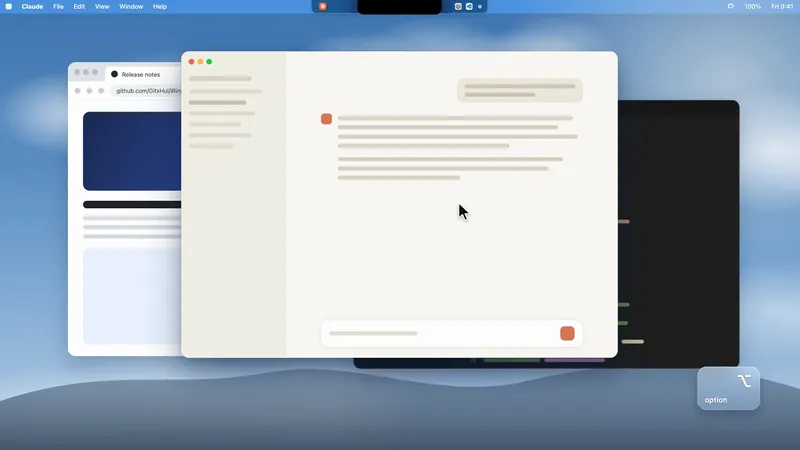
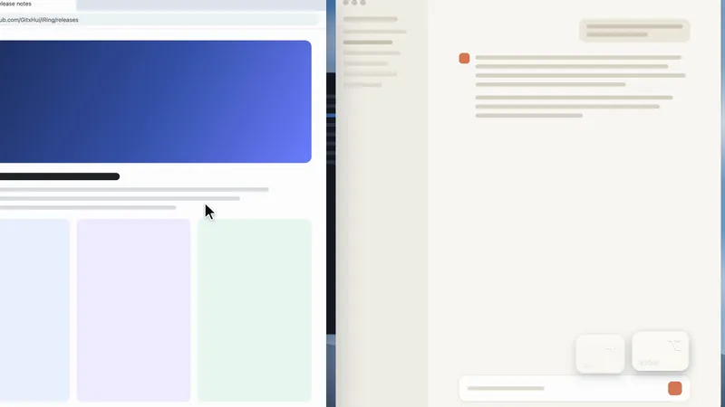
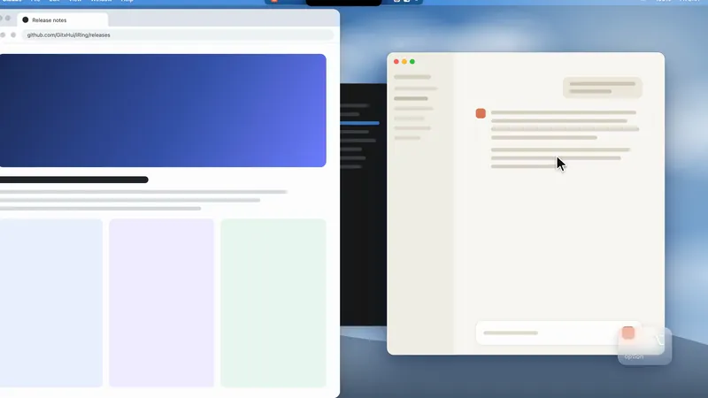

<p align="center">
  <picture>
    <source media="(prefers-color-scheme: dark)" srcset="docs/media/hero-en-dark.svg" />
    
  </picture>
</p>

<p align="center"><a href="README.md">简体中文</a> · <strong>English</strong></p>

<p align="center">
  <a href="#films"></a>
  <a href="#features"></a>
  <a href="#details"></a>
  <a href="#install"></a>
  <a href="#faq"></a>
</p>

<p align="center">
  <a href="https://github.com/GitxHui/iRing/releases/download/v0.1.0-beta.2/iRing-v0.1.0-beta.2-macOS-arm64.dmg"></a>
  <br />
  <sub>Free public beta · macOS 15 or later · Apple silicon · <a href="https://github.com/GitxHui/iRing/releases/tag/v0.1.0-beta.2">Beta 2 release notes</a></sub>
</p>

<p align="center">
  <a href="https://github.com/GitxHui/iRing/releases"></a>
  <a href="https://github.com/GitxHui/iRing/releases"></a>
  <a href="LICENSE"></a>
</p>

<br />

<p align="center">
  
  <br />
  <sub>Hold left ⌥ or the middle mouse button and the ring opens right at your cursor. Point, release, done.</sub>
</p>

<p align="center"></p>

## Films

<!-- To play a film inline: drag the mp4 into GitHub's web editor, copy the
     https://github.com/user-attachments/assets/… URL it creates, and paste it on its own line
     in place of the poster. -->
<table align="center">
  <tr>
    <td align="center" valign="middle">
      <a href="https://github.com/GitxHui/iRing/releases/download/v0.1.0-beta.2/iRing-promo-en.mp4"></a>
      <br /><b>Landscape film</b>
      <br /><sub>35 s · 1080p · sound on</sub>
    </td>
    <td align="center" valign="middle">
      <a href="https://github.com/GitxHui/iRing/releases/download/v0.1.0-beta.2/iRing-promo-vertical-en.mp4"></a>
      <br /><b>Vertical cut</b>
      <br /><sub>1080 × 1920 · sound on</sub>
    </td>
  </tr>
</table>

<p align="center"></p>

## Why iRing

<table>
  <tr>
    <td width="33%" valign="top">
      <h3>Works where<br />your cursor is</h3>
      <sub>No trips to the Dock or window corners. The ring opens at your pointer — point, release, done.</sub>
    </td>
    <td width="33%" valign="top">
      <h3>⌥ or the middle button.<br />Equally capable.</h3>
      <sub>Keyboard people hold left ⌥, mouse people hold the middle button. Switching, tiling and resizing all start from the same ring, leaving ⌘ and ⌃ free.</sub>
    </td>
    <td width="33%" valign="top">
      <h3>Native<br />Liquid Glass feel</h3>
      <sub>A frosted ring and dock that match macOS, with separately adjustable animation speeds.</sub>
    </td>
  </tr>
</table>

<p align="center"></p>

## Features

<table>
  <tr>
    <td width="50%" valign="top">
      
      <h3>01 · Switch</h3>
      <sub>Hold left <b>⌥</b> or the middle mouse button to open the ring, point at an app, and release. Windows keep their size and display by default.</sub>
    </td>
    <td width="50%" valign="top">
      
      <h3>02 · Tile</h3>
      <sub>While holding <b>⌥</b>, press <b>Tab</b> or tap the trackpad — or use <b>⌥ + middle button</b> — to open the tiling ring. Edges give <b>halves</b>, corners give <b>quarters</b>, the centre goes <b>full screen</b>. Preview before you let go.</sub>
    </td>
  </tr>
  <tr>
    <td width="50%" valign="top">
      
      <h3>03 · Resize</h3>
      <sub>With the ring open, swipe two fingers or scroll the mouse wheel to resize the selected window continuously from <b>45% to 100%</b>. Release to apply.</sub>
    </td>
    <td width="50%" valign="top">
      
      <h3>04 · Dock</h3>
      <sub>Tucks into a slim bar by the notch and expands into a dock of your favorite apps; drag it to any screen edge. Turn on number-key switching to jump to apps in dock order with <b>⌘ + 1–9</b> or another modifier.</sub>
    </td>
  </tr>
</table>

## Details

<table>
  <tr>
    <td width="33%" valign="top"><b>Mouse friendly</b><br /><sub>Hold the middle button and move to open the ring; <b>⌥ + middle button</b> opens the tiling ring. The trigger is customizable.</sub></td>
    <td width="33%" valign="top"><b>Multi-display aware</b><br /><sub>Switching keeps windows on their current displays, so reference material stays on your second screen.</sub></td>
    <td width="33%" valign="top"><b>Two looks</b><br /><sub>Liquid Glass or Obsidian, with adjustable transparency.</sub></td>
  </tr>
  <tr>
    <td width="33%" valign="top"><b>Your pace</b><br /><sub>Separate animation speeds for the dock and the ring, plus Vivid and Minimal &amp; Snappy presets.</sub></td>
    <td width="33%" valign="top"><b>App order</b><br /><sub>Sort by when you added apps or how often you use them, and hide apps that aren't running.</sub></td>
    <td width="33%" valign="top"><b>Bilingual</b><br /><sub>English and Simplified Chinese.</sub></td>
  </tr>
</table>

<details>
<summary><b>Shortcuts and mouse controls</b></summary>
<br />

| Action | Default control |
| --- | --- |
| Switch apps | Hold left **⌥** or the middle mouse button, point at an app, release |
| Tile a window | While holding **⌥**, press **Tab** or tap the trackpad; or **⌥ + middle mouse button** |
| Resize a window | With the ring open, swipe two fingers or scroll the mouse wheel |
| Show or hide the dock | **⌥ + Space** |
| Move the dock to the next display | **⌃ + ⌥ + →**, or drag it to another display |
| Jump to an app by dock position | Modifier + **1–9** (off by default; choose ⌘, ⌥, ⌃ and more in Shortcuts settings) |

You can also enable a dedicated tiling shortcut in Shortcuts settings. "Auto-Fit Window on Switch" and "Pull Apps from Other Displays" are separate toggles, both off by default.

</details>

<p align="center"></p>

## Install

1. Download the [Beta 2 DMG](https://github.com/GitxHui/iRing/releases/download/v0.1.0-beta.2/iRing-v0.1.0-beta.2-macOS-arm64.dmg) and drag **iRing.app** into **Applications**.
2. Open iRing, then enable it in **System Settings → Privacy & Security → Accessibility**. Accessibility permission is sufficient for switching, tiling, and resizing; iRing uses it to read and arrange the windows of apps on your Mac.

> [!NOTE]
> The beta is ad hoc signed and has yet to be notarized by Apple. If macOS blocks the first launch, first check the download against the SHA-256 checksum on the [release page](https://github.com/GitxHui/iRing/releases/tag/v0.1.0-beta.2). For a verified copy, run the following command and reopen the app.
>
> ```bash
> xattr -cr /Applications/iRing.app
> ```

The release page also provides a ZIP archive. Prebuilt packages target Apple silicon.

## FAQ

<details>
<summary><b>Does it run on Intel Macs?</b></summary>
<br />

Prebuilt packages target Apple silicon (arm64). Intel Mac users can try [building from source](#build-from-source).

</details>

<details>
<summary><b>Will left ⌥ clash with my shortcuts?</b></summary>
<br />

The ring uses only left ⌥. You can also open it with the middle mouse button, change the mouse trigger in settings, or enable a dedicated tiling shortcut in Shortcuts settings, which warns you about conflicts.

</details>

<details>
<summary><b>Does switching move windows to my current display?</b></summary>
<br />

Not by default — windows keep their size and display. Turn on "Pull Apps from Other Displays" if you want that.

</details>

<details>
<summary><b>How do I turn on number-key switching?</b></summary>
<br />

Enable it in Shortcuts settings and pick a modifier such as ⌘. Then modifier + 1–9 switches to the app in that position of the dock.

</details>

## Build from source

Requires macOS 15+ and Swift 6.2+. Run these commands from the repository root.

```bash
swift run AIStageSelfTest
./Scripts/build_app.sh
./Scripts/release.sh
```

Use `SKIP_INSTALL=1 ./Scripts/build_app.sh` to build without installing into Applications.

<sub>The promo films live in [`promo/`](promo/): a [Remotion](https://www.remotion.dev/) project where every frame is drawn in code and the music and sound effects are synthesized by script.</sub>

<p align="center"></p>

<p align="center">
  <sub><a href="CHANGELOG.md">Changelog</a> · <a href="LICENSE">MIT License</a> · <a href="https://github.com/GitxHui/iRing/issues">Report an issue</a></sub>
</p>
