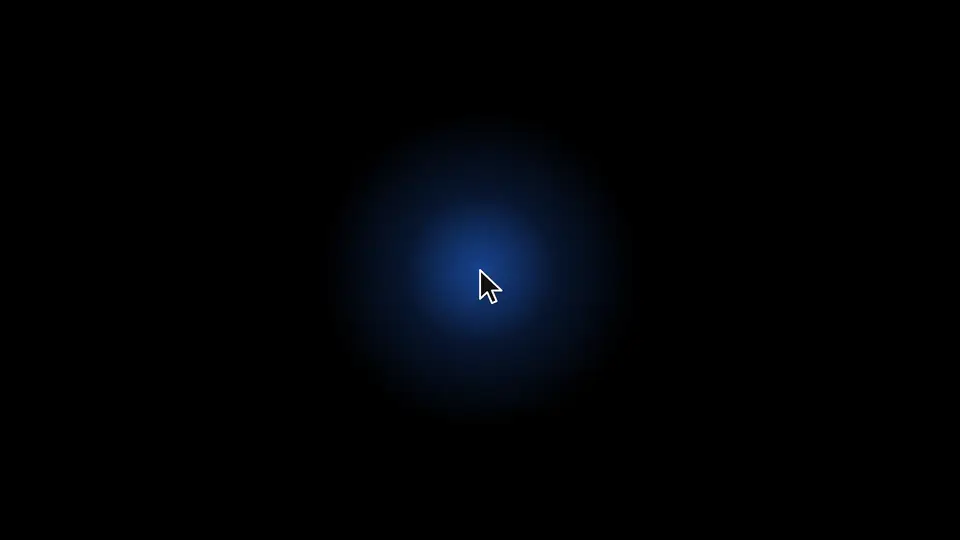
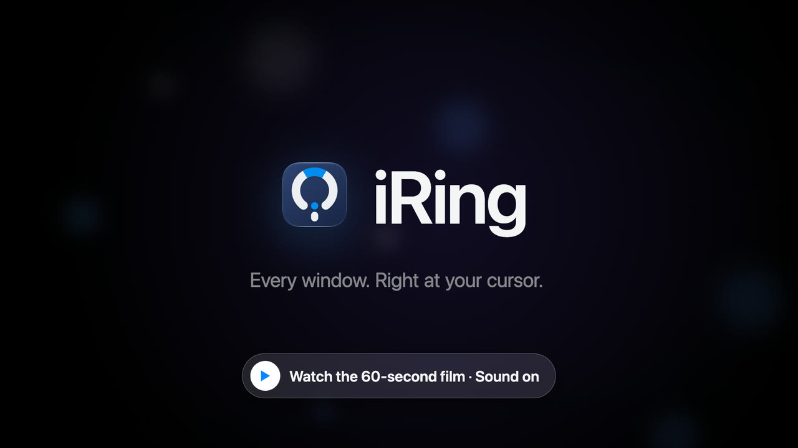
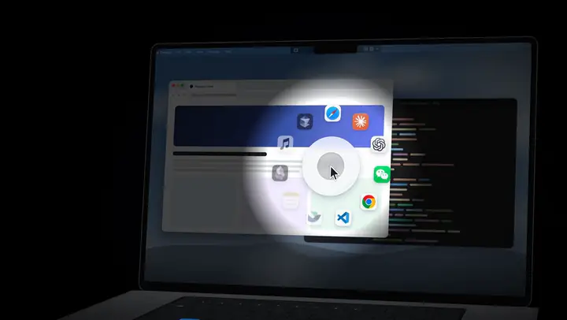
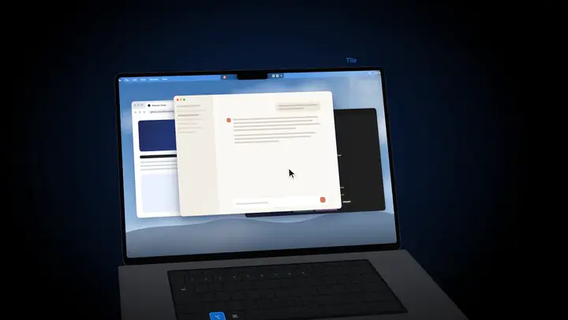
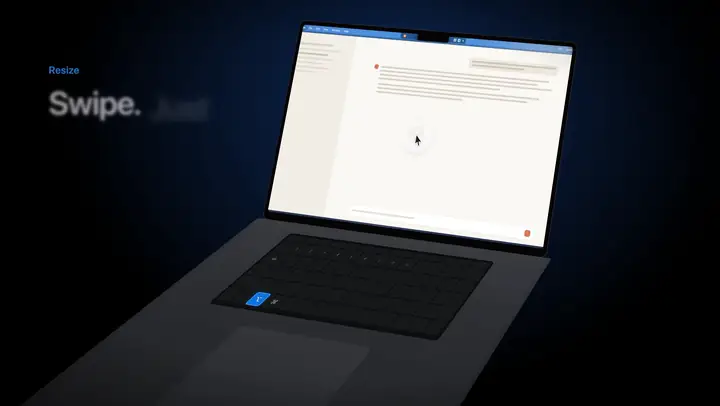
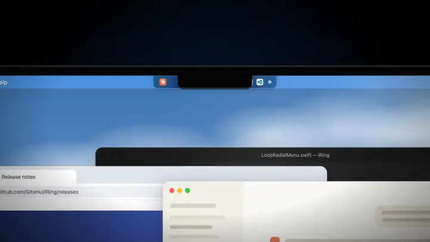
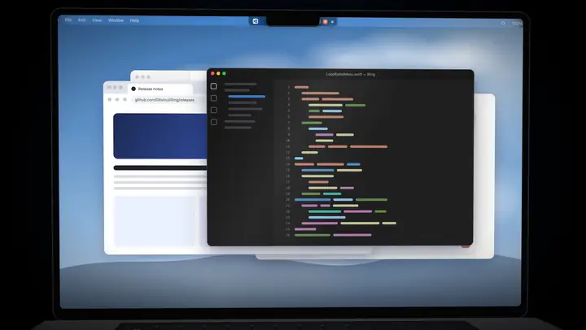

<p align="center">
  <picture>
    <source media="(prefers-color-scheme: dark)" srcset="docs/media/hero-en-dark.svg" />
    
  </picture>
</p>

<p align="center"><a href="README.md">简体中文</a> · <strong>English</strong></p>

<p align="center">
  <a href="#film"></a>
  <a href="#features"></a>
  <a href="#details"></a>
  <a href="#install"></a>
  <a href="#faq"></a>
</p>

<p align="center">
  <a href="https://github.com/GitxHui/iRing/releases/download/v0.1.0-beta.2/iRing-v0.1.0-beta.2-macOS-arm64.dmg"></a>
  <br />
  <a href="https://gitxhui.github.io/iRing/?lang=en">Website</a> · <a href="#install">Homebrew</a> · <a href="https://github.com/GitxHui/iRing/releases/download/v0.1.0-beta.2/iRing-v0.1.0-beta.2-macOS-arm64.zip">ZIP</a><br />
  <sub>Free public beta · macOS 15+ · Apple silicon · <a href="https://github.com/GitxHui/iRing/releases/tag/v0.1.0-beta.2">Beta 2 release notes</a></sub>
</p>

<p align="center">
  <a href="https://github.com/GitxHui/iRing/releases"></a>
  <a href="https://github.com/GitxHui/iRing/releases"></a>
  <a href="https://github.com/GitxHui/iRing/stargazers"></a>
  <a href="LICENSE"></a>
</p>

<br />

<p align="center">
  
  <br />
  <sub>Hold left ⌥ or the middle mouse button — the ring opens at your cursor. Point, release, done.</sub>
</p>

<p align="center"></p>

## Film

<!-- To play the film inline instead of linking out: open README.en.md in GitHub's web editor,
     drag the mp4 into it, copy the https://github.com/user-attachments/assets/… URL it creates,
     and paste that URL on its own line in place of the poster below. -->
<p align="center">
  <a href="https://github.com/GitxHui/iRing/releases/download/v0.1.0-beta.2/iRing-film-en.mp4"></a>
  <br />
  <sub>60-second keynote cut · sound on · <a href="https://github.com/GitxHui/iRing/releases/download/v0.1.0-beta.2/iRing-promo-vertical-en.mp4">Vertical cut for social</a></sub>
</p>

<p align="center"></p>

## Why iRing

<table>
  <tr>
    <td width="33%" valign="top">
      <h3>Act where<br />your cursor is</h3>
      <sub>No more trips to the Dock, the menu bar or a window corner. The ring opens right under your pointer.</sub>
    </td>
    <td width="33%" valign="top">
      <h3>Two ways in,<br />one ring</h3>
      <sub>Hold left ⌥ on the keyboard, or the middle button on the mouse. Same ring, same powers.</sub>
    </td>
    <td width="33%" valign="top">
      <h3>One ring,<br />four powers</h3>
      <sub>Switch apps, tile windows, resize them, and keep your favourites in an island by the notch.</sub>
    </td>
  </tr>
</table>

<p align="center"></p>

## Features

### Two ways in: ⌥ or the middle mouse button

Keyboard people hold left **⌥**. Mouse people hold the **middle button**. Both open the same ring at the cursor, and you can remap the mouse trigger to the middle or a side button.

<p align="center"></p>

### Switch: point, release

Point at an app and let go — it comes straight to the front. Windows keep their size and stay on their display by default.

<p align="center"></p>

### Tile: halves · quarters · full screen

Inside the ring, press **Tab** or tap the trackpad (or use **⌥ + middle button**) to open the tiling ring. Edges give halves, corners give quarters, the centre goes full screen — and you see a preview before you let go.

<p align="center"></p>

### Resize: swipe, just right

With the ring open, swipe two fingers or scroll the mouse wheel to resize the selected window continuously from **45% to 100%**. Release to apply.

<p align="center"></p>

### The island: your apps, by the notch

Collapsed, it's a slim bar around the notch. Hover to expand your favourite apps, with unread badges. Drag it to any screen edge, toggle it with **⌥ + Space**, and send it to the next display with **⌃ + ⌥ + →**. Turn on number-key switching to jump by slot with a modifier + **1–9** (off by default).

<p align="center"></p>

<p align="center"></p>

## Details

<p align="center"></p>

<table>
  <tr>
    <td width="33%" valign="top"><b>Multi-display aware</b><br /><sub>Switching leaves windows on their own displays, so reference material stays on your second screen.</sub></td>
    <td width="33%" valign="top"><b>Liquid Glass &amp; Obsidian</b><br /><sub>Two looks for the ring and the island, with adjustable transparency.</sub></td>
    <td width="33%" valign="top"><b>Particles &amp; motion</b><br /><sub>Separate animation speeds for the ring and the island, plus Vivid and Minimal &amp; Snappy presets.</sub></td>
  </tr>
  <tr>
    <td width="33%" valign="top"><b>App order</b><br /><sub>Sort by the order you added apps or by how often you use them, with running apps first.</sub></td>
    <td width="33%" valign="top"><b>Switch behaviour</b><br /><sub>Optional "Auto-Fit Window on Switch", "Pull Apps from Other Displays", and a cursor that follows the switched window.</sub></td>
    <td width="33%" valign="top"><b>English &amp; 中文</b><br /><sub>Bilingual interface, and iRing can launch at login.</sub></td>
  </tr>
</table>

<p align="center"></p>

## Quick start

1. Download the DMG and drag **iRing.app** into **Applications**.
2. Open iRing and allow it in **System Settings → Privacy & Security → Accessibility**.
3. Hold left **⌥** or the middle mouse button. The ring appears at your cursor.

| | ⌥ key (keyboard / trackpad) | Middle mouse button |
| --- | --- | --- |
| **Open the ring** | Hold left **⌥** | Hold the middle button |
| **Switch** | Point, release **⌥** | Point, release the button |
| **Tile** | **Tab** or a trackpad tap while the ring is open | **⌥ + middle button** |
| **Resize** | Two-finger swipe while the ring is open | Scroll the wheel while the ring is open |

<details>
<summary><b>All shortcuts</b></summary>
<br />

| Action | Default control |
| --- | --- |
| Switch apps | Hold left **⌥** or the middle mouse button, point at an app, release |
| Tile a window | While holding **⌥**, press **Tab** or tap the trackpad; or **⌥ + middle mouse button** |
| Resize a window | With the ring open, swipe two fingers or scroll the mouse wheel |
| Show or hide the island | **⌥ + Space** |
| Move the island to the next display | **⌃ + ⌥ + →**, or drag it to another display |
| Jump to an app by island slot | Modifier + **1–9** (off by default; choose ⌘, ⌥, ⌃ and more in Shortcuts settings) |

You can also enable a dedicated tiling shortcut in Shortcuts settings, which warns you about conflicts. "Auto-Fit Window on Switch" and "Pull Apps from Other Displays" are separate toggles, both off by default.

</details>

<p align="center"></p>

## Compared with

<table align="center">
  <thead>
    <tr>
      <th align="left"></th>
      <th><b>iRing</b></th>
      <th>Loop</th>
      <th>Rectangle</th>
      <th>AltTab</th>
      <th>macOS built-in</th>
    </tr>
  </thead>
  <tbody>
    <tr>
      <td align="left">Switch apps</td>
      <td align="center">✅</td>
      <td align="center"><sub>—</sub></td>
      <td align="center"><sub>—</sub></td>
      <td align="center">✅</td>
      <td align="center">✅</td>
    </tr>
    <tr>
      <td align="left">Tile windows (halves / quarters / full)</td>
      <td align="center">✅</td>
      <td align="center">✅</td>
      <td align="center">✅</td>
      <td align="center"><sub>—</sub></td>
      <td align="center">✅</td>
    </tr>
    <tr>
      <td align="left">Radial ring at the cursor</td>
      <td align="center">✅</td>
      <td align="center">✅</td>
      <td align="center"><sub>—</sub></td>
      <td align="center"><sub>—</sub></td>
      <td align="center"><sub>—</sub></td>
    </tr>
    <tr>
      <td align="left">Switching and tiling in one ring</td>
      <td align="center">✅</td>
      <td align="center"><sub>—</sub></td>
      <td align="center"><sub>—</sub></td>
      <td align="center"><sub>—</sub></td>
      <td align="center"><sub>—</sub></td>
    </tr>
    <tr>
      <td align="left">App dock by the notch</td>
      <td align="center">✅</td>
      <td align="center"><sub>—</sub></td>
      <td align="center"><sub>—</sub></td>
      <td align="center"><sub>—</sub></td>
      <td align="center"><sub>—</sub></td>
    </tr>
    <tr>
      <td align="left">Free</td>
      <td align="center">✅</td>
      <td align="center">✅</td>
      <td align="center">✅</td>
      <td align="center">✅</td>
      <td align="center">✅</td>
    </tr>
    <tr>
      <td align="left">Open source</td>
      <td align="center">✅</td>
      <td align="center">✅</td>
      <td align="center">✅</td>
      <td align="center">✅</td>
      <td align="center"><sub>—</sub></td>
    </tr>
  </tbody>
</table>

<p align="center"><sub>All great tools that can live side by side. Based on each project's public docs; “—” means not offered. Corrections welcome.</sub></p>

<p align="center"></p>

## Install

- **Manual install.** Download from the [website](https://gitxhui.github.io/iRing/?lang=en) or get the [DMG](https://github.com/GitxHui/iRing/releases/download/v0.1.0-beta.2/iRing-v0.1.0-beta.2-macOS-arm64.dmg) / [ZIP](https://github.com/GitxHui/iRing/releases/download/v0.1.0-beta.2/iRing-v0.1.0-beta.2-macOS-arm64.zip) directly. Drag **iRing.app** to **Applications**.
- **Homebrew.** Install the same beta from the project's [tap](https://github.com/GitxHui/homebrew-tap).

```sh
brew install --cask gitxhui/tap/iring
```

Open iRing and enable it in **System Settings → Privacy & Security → Accessibility**.

> [!NOTE]
> The beta is ad hoc signed and has yet to be notarized by Apple. If macOS blocks the first launch, first check the download against the SHA-256 checksum on the [release page](https://github.com/GitxHui/iRing/releases/tag/v0.1.0-beta.2). For a verified copy, run the following command and reopen the app.
>
> ```bash
> xattr -cr /Applications/iRing.app
> ```

**Permissions & privacy.** Accessibility permission is all switching, tiling and resizing need — iRing uses it to read and arrange the windows of the apps on your Mac.

## FAQ

<details>
<summary><b>Does it run on Intel Macs?</b></summary>
<br />

Prebuilt packages target Apple silicon (arm64). Intel Mac users can try [building from source](#build-from-source).

</details>

<details>
<summary><b>How do I turn on number-key switching?</b></summary>
<br />

It's off by default. Enable it in Shortcuts settings and pick a modifier such as ⌘. Then modifier + 1–9 jumps to the app in that slot of the island.

</details>

<details>
<summary><b>It stopped working after an update.</b></summary>
<br />

Open **System Settings → Privacy & Security → Accessibility**, remove iRing from the list, add it again, then relaunch iRing.

</details>

<details>
<summary><b>How do I change the triggers?</b></summary>
<br />

In Shortcuts settings you can change the mouse trigger (middle or side button), enable a dedicated tiling shortcut, and set the number-key modifier. iRing warns you if a shortcut conflicts.

</details>

<details>
<summary><b>How do I uninstall?</b></summary>
<br />

Quit iRing, drag it from Applications to the Trash, then remove its entry in **System Settings → Privacy & Security → Accessibility**.

</details>

## Build from source

Requires macOS 15+ and Swift 6.2+. Run these commands from the repository root.

```bash
swift run AIStageSelfTest
./Scripts/build_app.sh
./Scripts/release.sh
```

Use `SKIP_INSTALL=1 ./Scripts/build_app.sh` to build without installing into Applications.

<sub>The promo film lives in [`promo/`](promo/): a [Remotion](https://www.remotion.dev/) project where every frame is drawn in code, and the music and sound effects are synthesized by script.</sub>

<p align="center"></p>

<p align="center">
  <sub><a href="CHANGELOG.md">Changelog</a> · <a href="LICENSE">MIT License</a> · <a href="https://github.com/GitxHui/iRing/issues">Report an issue</a></sub>
</p>
