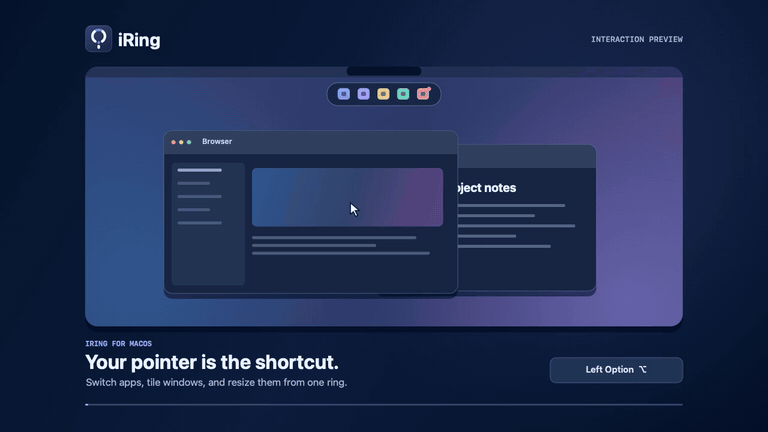

<div align="center">
  
  <h1>iRing</h1>
  <p><strong>简体中文</strong> · <a href="README.en.md">English</a></p>
  <p><strong>切应用、分屏、缩放，都在光标处完成。</strong><br />
  按住左 Option（⌥）呼出圆环，用触控板或鼠标整理窗口。</p>
  <p><a href="https://github.com/GitxHui/iRing/releases/download/v0.1.0-beta.2/iRing-v0.1.0-beta.2-macOS-arm64.dmg"><strong>下载 macOS Beta（.dmg）</strong></a> · <a href="https://github.com/GitxHui/iRing/releases/tag/v0.1.0-beta.2">Beta 2 版本说明</a><br />
  macOS 15.0 或更新版本 · Apple 芯片（arm64）</p>
</div>

<p align="center">
  
  <br /><sub>15 秒交互动效示意</sub>
</p>

## 三个手势快速上手

| 操作 | 手势 |
| --- | --- |
| **切应用** | 按住左 **⌥** 呼出圆环，将光标指向目标应用，松手切换。 |
| **分屏** | 按住 **⌥** 时按 **Tab** 或轻点触控板。指向上、下、左、右半屏或四角四分之一屏可预览布局，选中心可最大化。松手应用。 |
| **连续缩放** | 圆环打开时双指滑动或滚动鼠标滚轮，在 **45%～100%** 之间调节选中的窗口，松手应用。 |

## 把常用应用停靠在 Liquid Glass 灵动岛

灵动岛可以贴合 MacBook 刘海，也能停靠在屏幕任意一边。收起后是一条窄胶囊，仍可查看支持应用的未读提示。可以选择 Liquid Glass 或曜石黑外观，单独调节灵动岛和圆环的动画速度。

切换应用时，iRing 默认保留窗口原有尺寸和所在屏幕。在多屏工作时，可以继续把参考资料留在副屏。需要时也可在设置中开启切换时自动铺满，或把选中的窗口拉到灵动岛所在的屏幕。

<details>
<summary>鼠标操作与灵动岛快捷键</summary>

| 操作 | 默认方式 |
| --- | --- |
| 鼠标呼出应用圆环 | 按住鼠标中键并移动光标。 |
| 鼠标打开分屏环 | **⌥ + 鼠标中键** |
| 显示或隐藏灵动岛 | **⌥ + Space** |
| 灵动岛移到下一块屏幕 | **⌃ + ⌥ + →**，也可直接拖拽跨屏。 |

可以在设置中更换鼠标触发键、开启独立分屏键，或按添加顺序和使用频次排列应用。界面支持简体中文和英语。

</details>

## 下载与安装

1. 打开 [Beta 2 安装包](https://github.com/GitxHui/iRing/releases/download/v0.1.0-beta.2/iRing-v0.1.0-beta.2-macOS-arm64.dmg)，将 **iRing.app** 拖入「应用程序」。
2. 打开 iRing，在「系统设置 → 隐私与安全性 → 辅助功能」中启用 iRing。切应用、分屏和缩放只需要辅助功能权限。

Beta 采用临时签名，暂未经过 Apple 公证。如果 macOS 阻止首次打开，先对照[发布页](https://github.com/GitxHui/iRing/releases/tag/v0.1.0-beta.2)的 SHA-256 校验值。确认下载无误后，在终端执行以下命令，再重新打开 iRing。

```bash
xattr -cr /Applications/iRing.app
```

发布页也提供 ZIP 版本。预编译包支持 Apple 芯片，Intel Mac 可以尝试从源码构建。

## 从源码构建

需要 macOS 15.0 或更新版本和 Swift 6.2 或更新版本。在仓库根目录运行以下命令。

```bash
swift run AIStageSelfTest
./Scripts/build_app.sh
./Scripts/release.sh
```

如果只构建应用包，可以运行 `SKIP_INSTALL=1 ./Scripts/build_app.sh`。

[更新记录](CHANGELOG.md) · [MIT 协议](LICENSE) · [反馈问题](https://github.com/GitxHui/iRing/issues)
