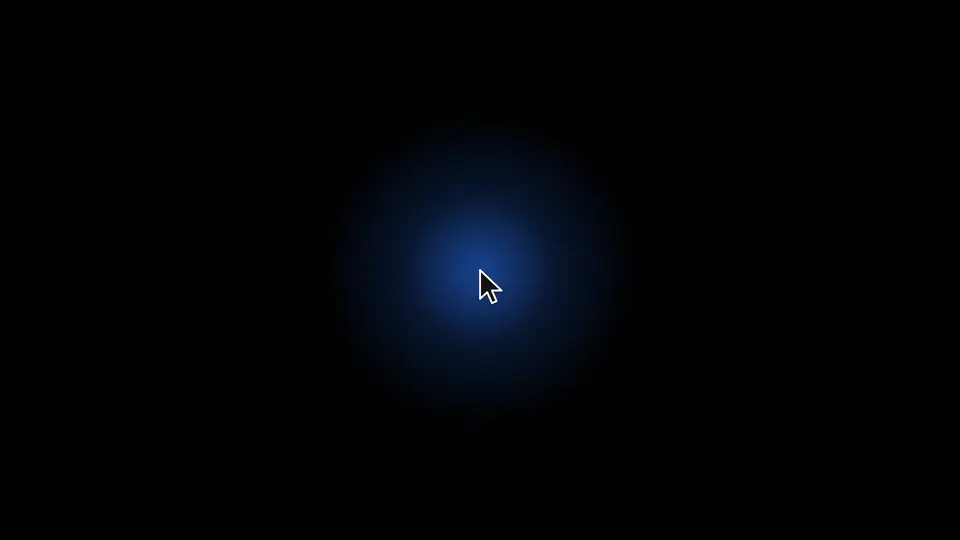
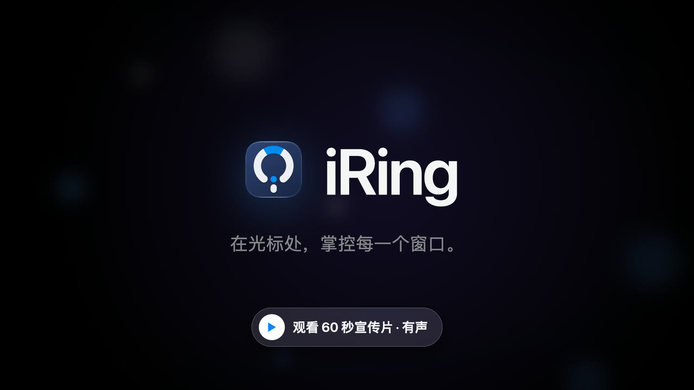
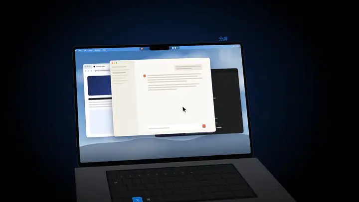
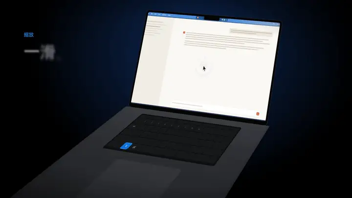
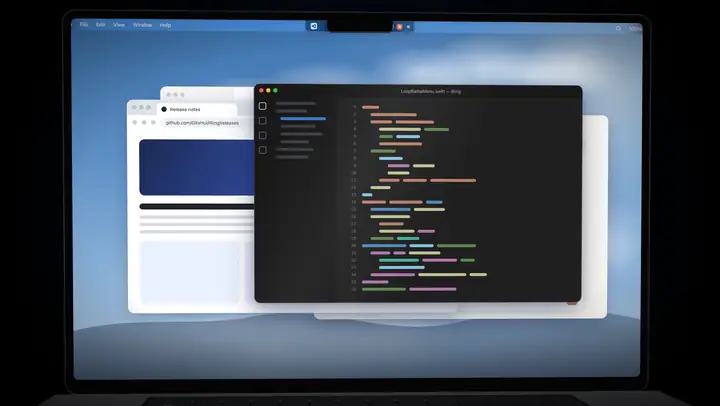

<p align="center">
  <picture>
    <source media="(prefers-color-scheme: dark)" srcset="docs/media/hero-zh-dark.svg" />
    
  </picture>
</p>

<p align="center"><strong>简体中文</strong> · <a href="README.en.md">English</a></p>

<p align="center">
  <a href="#影片"></a>
  <a href="#核心功能"></a>
  <a href="#更多细节"></a>
  <a href="#下载与安装"></a>
  <a href="#常见问题"></a>
</p>

<p align="center">
  <a href="https://github.com/GitxHui/iRing/releases/download/v0.1.0-beta.2/iRing-v0.1.0-beta.2-macOS-arm64.dmg"></a>
  <br />
  <a href="https://gitxhui.github.io/iRing/?lang=zh">官网</a> · <a href="#下载与安装">Homebrew</a> · <a href="https://github.com/GitxHui/iRing/releases/download/v0.1.0-beta.2/iRing-v0.1.0-beta.2-macOS-arm64.zip">ZIP</a><br />
  <sub>免费公测 · macOS 15+ · Apple 芯片 · <a href="https://github.com/GitxHui/iRing/releases/tag/v0.1.0-beta.2">Beta 2 版本说明</a></sub>
</p>

<p align="center">
  <a href="https://github.com/GitxHui/iRing/releases"></a>
  <a href="https://github.com/GitxHui/iRing/releases"></a>
  <a href="https://github.com/GitxHui/iRing/stargazers"></a>
  <a href="LICENSE"></a>
</p>

<br />

<p align="center">
  
  <br />
  <sub>按住左 ⌥ 或鼠标中键，圆环就在光标处打开。指一下，松手，完成。</sub>
</p>

<p align="center"></p>

## 影片

<!-- 想在页面内直接播放：在 GitHub 网页编辑器里把 promo/out/iring-film-zh-1080p.mp4 拖进来，
     会得到一个 https://github.com/user-attachments/assets/… 链接，把它单独放一行，即可替换下面的封面。 -->
<p align="center">
  <a href="https://github.com/GitxHui/iRing/releases/download/v0.1.0-beta.2/iRing-film-zh.mp4"></a>
  <br />
  <sub><a href="https://github.com/GitxHui/iRing/releases/download/v0.1.0-beta.2/iRing-film-zh.mp4">60 秒发布会版 · 有声</a> · <a href="https://github.com/GitxHui/iRing/releases/download/v0.1.0-beta.2/iRing-promo-vertical-zh.mp4">抖音 / 小红书竖版</a></sub>
</p>

<p align="center"></p>

## 为什么是 iRing

<table>
  <tr>
    <td width="33%" valign="top">
      <h3>光标在哪，<br />操作就在哪</h3>
      <sub>不必把鼠标挪去 Dock、菜单栏或窗口角落。圆环直接在光标处展开，指一下、松手就完成。</sub>
    </td>
    <td width="33%" valign="top">
      <h3>两种入口，<br />同一个圆环</h3>
      <sub>键盘上按住左 ⌥，鼠标上按住中键。两个入口地位对等，打开的是同一个圆环。</sub>
    </td>
    <td width="33%" valign="top">
      <h3>一个圆环，<br />四种能力</h3>
      <sub>切换、分屏、缩放都在圆环里完成，常用应用停靠在刘海旁的灵动岛。</sub>
    </td>
  </tr>
</table>

<p align="center"></p>

## 核心功能

### 两种入口：⌥ 或鼠标中键

键盘用户按住左 **⌥**，鼠标用户按住**中键**，圆环就在光标处打开，之后的操作完全一样。鼠标触发键可以在设置中换成侧键。

<p align="center"></p>

### 切换：指向，松手

指向目标应用，松手即切换。窗口默认保留原有尺寸和所在屏幕。

<p align="center"></p>

### 分屏：二分 · 四分 · 全屏

圆环打开时按 **Tab** 或轻点触控板，或者用 **⌥ + 鼠标中键**，进入分屏环。上下左右是二分屏，四角是四分屏，中心是全屏。指向方向先看预览，松手才落位。

<p align="center"></p>

### 缩放：一滑，刚刚好

圆环打开时双指滑动触控板或滚动鼠标滚轮，在 **45%～100%** 之间连续调节选中的窗口，松手应用。

<p align="center"></p>

### 灵动岛：常用应用，就在刘海旁

收起时是贴着屏幕顶边、包住刘海的一条细条，悬停即展开成常用应用 Dock，并同步支持应用的未读红点。它可以拖到屏幕任意一边停靠，**⌥ + Space** 显示或隐藏，**⌃ + ⌥ + →** 移到下一块屏幕。在设置中开启数字切换后，按修饰键 + **1～9** 即可按灵动岛里的顺序直达应用。

<p align="center"></p>

<p align="center"></p>

## 更多细节

<p align="center"></p>

<table>
  <tr>
    <td width="50%" valign="top"><b>多屏友好</b><br /><sub>切换应用时默认不改变窗口所在屏幕，副屏上的参考资料原地不动。</sub></td>
    <td width="50%" valign="top"><b>Liquid Glass 与曜石黑</b><br /><sub>两种外观可选，通透度、圆环大小和颜色都可以调整。</sub></td>
  </tr>
  <tr>
    <td width="50%" valign="top"><b>粒子与动效</b><br /><sub>圆环带粒子动效，灵动岛和圆环的动画速度分别可调，内置「灵动模式」与「极简极速」两种预设。</sub></td>
    <td width="50%" valign="top"><b>应用排序</b><br /><sub>按添加顺序或使用频次排列，可让运行中的应用排在前面，也可隐藏未启动的应用。</sub></td>
  </tr>
  <tr>
    <td width="50%" valign="top"><b>切换行为</b><br /><sub>切窗时自动铺满屏幕、多屏时将应用拉回当前屏幕、切窗时鼠标自动跟随，都是可选开关。</sub></td>
    <td width="50%" valign="top"><b>双语与自启</b><br /><sub>界面支持简体中文和英语，可设置开机自启动。</sub></td>
  </tr>
</table>

<p align="center"></p>

## 快速上手

1. [下载 iRing](https://github.com/GitxHui/iRing/releases/download/v0.1.0-beta.2/iRing-v0.1.0-beta.2-macOS-arm64.dmg)，将 **iRing.app** 拖入「应用程序」。
2. 打开 iRing，在「系统设置 → 隐私与安全性 → 辅助功能」中启用它。
3. 按住左 **⌥** 或鼠标中键，圆环就会出现在光标处。

**操作速查**

| 操作 | ⌥ 键（键盘 / 触控板） | 鼠标中键 |
| --- | --- | --- |
| 打开圆环 | 按住左 **⌥** | 按住**中键** |
| 切换 | 指向应用，松开 ⌥ | 指向应用，松开中键 |
| 分屏 | 圆环打开时按 **Tab** 或轻点触控板 | **⌥ + 中键** |
| 缩放 | 圆环打开时双指滑动 | 圆环打开时滚动滚轮 |

<details>
<summary><b>全部快捷键</b></summary>
<br />

| 操作 | 默认方式 |
| --- | --- |
| 切应用 | 按住左 **⌥**，或按住鼠标中键，指向应用后松手 |
| 分屏 | 按住 **⌥** 时按 **Tab** 或轻点触控板；或 **⌥ + 鼠标中键** |
| 缩放窗口 | 圆环打开时双指滑动，或滚动鼠标滚轮 |
| 显示或隐藏灵动岛 | **⌥ + Space** |
| 灵动岛移到下一块屏幕 | **⌃ + ⌥ + →**，也可直接拖拽跨屏 |
| 按顺序直达灵动岛里的应用 | 修饰键 + **1～9**（默认关闭，可在「快捷键」设置中选择 ⌘、⌥、⌃ 等组合） |

还可以在「快捷键」设置中开启独立的分屏触发键，开启时会提示快捷键冲突。

</details>

<p align="center"></p>

## 与同类工具

<table align="center">
  <thead>
    <tr>
      <th align="left"></th>
      <th><b>iRing</b></th>
      <th>Loop</th>
      <th>Rectangle</th>
      <th>AltTab</th>
      <th>macOS 自带</th>
    </tr>
  </thead>
  <tbody>
    <tr>
      <td align="left">切换应用</td>
      <td align="center">✅</td>
      <td align="center"><sub>—</sub></td>
      <td align="center"><sub>—</sub></td>
      <td align="center">✅</td>
      <td align="center">✅</td>
    </tr>
    <tr>
      <td align="left">分屏布局（二分 / 四分 / 全屏）</td>
      <td align="center">✅</td>
      <td align="center">✅</td>
      <td align="center">✅</td>
      <td align="center"><sub>—</sub></td>
      <td align="center">✅</td>
    </tr>
    <tr>
      <td align="left">在光标处用圆环操作</td>
      <td align="center">✅</td>
      <td align="center">✅</td>
      <td align="center"><sub>—</sub></td>
      <td align="center"><sub>—</sub></td>
      <td align="center"><sub>—</sub></td>
    </tr>
    <tr>
      <td align="left">切换与分屏在同一个圆环</td>
      <td align="center">✅</td>
      <td align="center"><sub>—</sub></td>
      <td align="center"><sub>—</sub></td>
      <td align="center"><sub>—</sub></td>
      <td align="center"><sub>—</sub></td>
    </tr>
    <tr>
      <td align="left">刘海旁的常用应用栏</td>
      <td align="center">✅</td>
      <td align="center"><sub>—</sub></td>
      <td align="center"><sub>—</sub></td>
      <td align="center"><sub>—</sub></td>
      <td align="center"><sub>—</sub></td>
    </tr>
    <tr>
      <td align="left">免费</td>
      <td align="center">✅</td>
      <td align="center">✅</td>
      <td align="center">✅</td>
      <td align="center">✅</td>
      <td align="center">✅</td>
    </tr>
    <tr>
      <td align="left">开源</td>
      <td align="center">✅</td>
      <td align="center">✅</td>
      <td align="center">✅</td>
      <td align="center">✅</td>
      <td align="center"><sub>—</sub></td>
    </tr>
  </tbody>
</table>

<p align="center"><sub>各工具都很优秀，可以并存。对比基于各项目公开资料，「—」表示未提供该能力，如有出入欢迎指正。</sub></p>

<p align="center"></p>

## 下载与安装

- **手动安装**：从[官网](https://gitxhui.github.io/iRing/?lang=zh)下载，或直接下载 [DMG](https://github.com/GitxHui/iRing/releases/download/v0.1.0-beta.2/iRing-v0.1.0-beta.2-macOS-arm64.dmg) / [ZIP](https://github.com/GitxHui/iRing/releases/download/v0.1.0-beta.2/iRing-v0.1.0-beta.2-macOS-arm64.zip)，将 **iRing.app** 拖入「应用程序」。
- **Homebrew**：从项目的 [Tap](https://github.com/GitxHui/homebrew-tap) 安装同一个公测版。

```sh
brew install --cask gitxhui/tap/iring
```

打开 iRing 后，在「系统设置 → 隐私与安全性 → 辅助功能」中启用 iRing。

> [!NOTE]
> Beta 采用临时签名，暂未经过 Apple 公证。如果 macOS 阻止首次打开，先对照[发布页](https://github.com/GitxHui/iRing/releases/tag/v0.1.0-beta.2)的 SHA-256 校验值。确认下载无误后，在终端执行以下命令，再重新打开 iRing。
>
> ```bash
> xattr -cr /Applications/iRing.app
> ```

**权限与隐私**：切换、分屏和缩放只需要辅助功能权限，用来读取和调整你本机应用的窗口。

## 常见问题

<details>
<summary><b>Intel Mac 能用吗？</b></summary>
<br />

预编译包只支持 Apple 芯片（arm64）。Intel Mac 可以尝试[从源码构建](#从源码构建)。

</details>

<details>
<summary><b>数字键切换怎么开启？</b></summary>
<br />

数字切换默认关闭。在「快捷键」设置中开启，并选择修饰键（如 ⌘）。之后按修饰键 + 1～9，就会切到灵动岛里对应位置的应用。

</details>

<details>
<summary><b>更新后不生效怎么办？</b></summary>
<br />

打开「系统设置 → 隐私与安全性 → 辅助功能」，移除 iRing 后重新添加并勾选，然后重启 iRing。

</details>

<details>
<summary><b>怎么改触发键？</b></summary>
<br />

在设置的「快捷键」中可以更换切应用和分屏圆环的快捷键；鼠标触发键可以录制为中键或侧键。

</details>

<details>
<summary><b>怎么卸载？</b></summary>
<br />

退出 iRing，把它从「应用程序」拖入废纸篓，再到「系统设置 → 隐私与安全性 → 辅助功能」中移除对应条目。

</details>

## 从源码构建

需要 macOS 15.0 或更新版本和 Swift 6.2 或更新版本。在仓库根目录运行以下命令。

```bash
swift run AIStageSelfTest
./Scripts/build_app.sh
./Scripts/release.sh
```

如果只构建应用包，可以运行 `SKIP_INSTALL=1 ./Scripts/build_app.sh`。

<sub>宣传片源码在 [`promo/`](promo/)：一个 [Remotion](https://www.remotion.dev/) 项目，画面全部用代码绘制，配乐和音效也由脚本合成。</sub>

<p align="center"></p>

<p align="center">
  <sub><a href="CHANGELOG.md">更新记录</a> · <a href="LICENSE">MIT 协议</a> · <a href="https://github.com/GitxHui/iRing/issues">反馈问题</a></sub>
</p>
