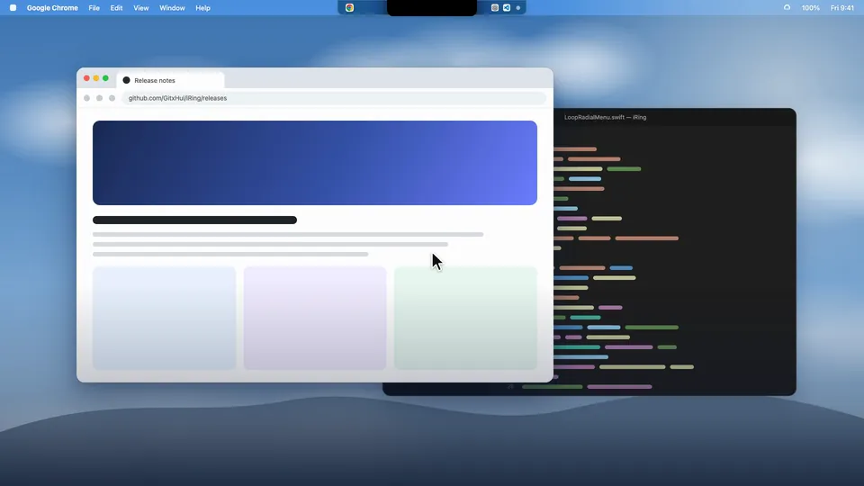
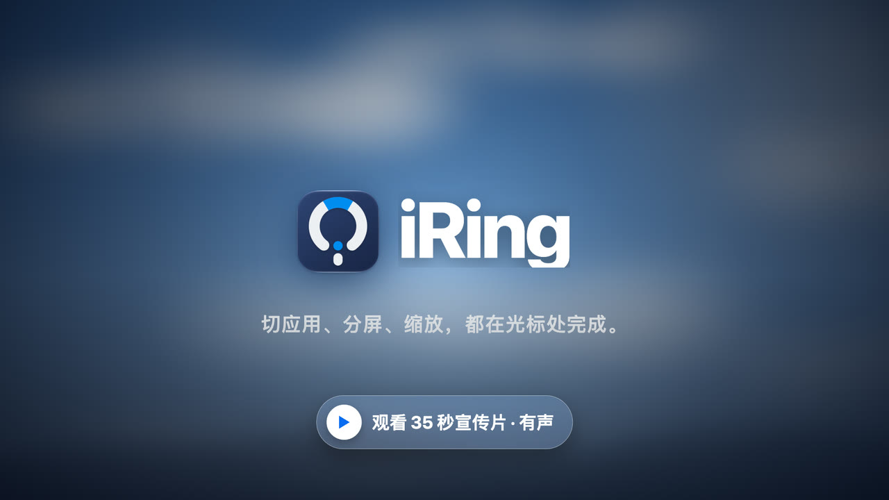
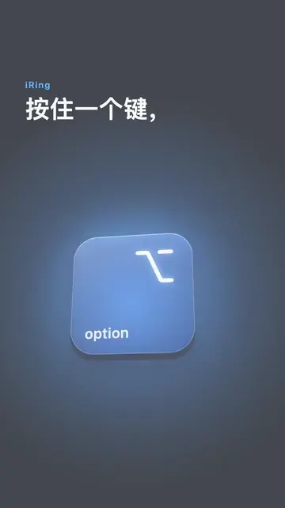
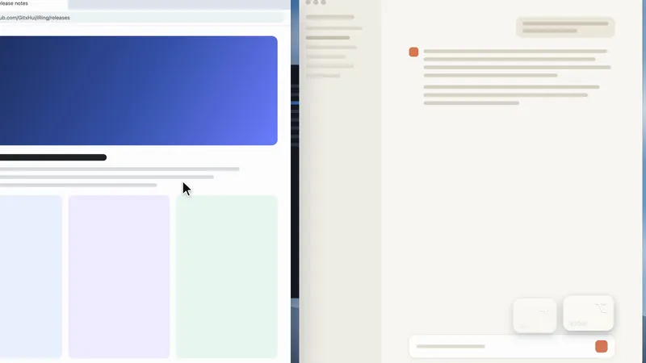

<p align="center">
  <picture>
    <source media="(prefers-color-scheme: dark)" srcset="docs/media/hero-zh-dark.svg" />
    
  </picture>
</p>

<p align="center"><strong>简体中文</strong> · <a href="README.en.md">English</a></p>

<p align="center">
  <a href="#影片"></a>
  <a href="#核心功能"></a>
  <a href="#更多细节"></a>
  <a href="#下载与安装"></a>
  <a href="#常见问题"></a>
</p>

<p align="center">
  <a href="https://github.com/GitxHui/iRing/releases/download/v0.1.0-beta.2/iRing-v0.1.0-beta.2-macOS-arm64.dmg"></a>
  <br />
  <sub>免费公测 · macOS 15 或更新版本 · Apple 芯片 · <a href="https://github.com/GitxHui/iRing/releases/tag/v0.1.0-beta.2">Beta 2 版本说明</a></sub>
</p>

<p align="center">
  <a href="https://github.com/GitxHui/iRing/releases"></a>
  <a href="https://github.com/GitxHui/iRing/releases"></a>
  <a href="LICENSE"></a>
</p>

<br />

<p align="center">
  
  <br />
  <sub>按住左 ⌥ 或鼠标中键，圆环就在光标处打开。指一下，松手，完成。</sub>
</p>

<p align="center"></p>

## 影片

<!-- 想在页面内直接播放：在 GitHub 网页编辑器里把对应 mp4 拖进来，会得到一个
     https://github.com/user-attachments/assets/… 链接，把它单独放一行即可替换海报。 -->
<table align="center">
  <tr>
    <td align="center" valign="middle">
      <a href="https://github.com/GitxHui/iRing/releases/download/v0.1.0-beta.2/iRing-promo-zh.mp4"></a>
      <br /><b>横版宣传片</b>
      <br /><sub>35 秒 · 1080p · 有声</sub>
    </td>
    <td align="center" valign="middle">
      <a href="https://github.com/GitxHui/iRing/releases/download/v0.1.0-beta.2/iRing-promo-vertical-zh.mp4"></a>
      <br /><b>竖版 · 抖音 / 小红书</b>
      <br /><sub>1080 × 1920 · 有声</sub>
    </td>
  </tr>
</table>

<p align="center"></p>

## 为什么是 iRing

<table>
  <tr>
    <td width="33%" valign="top">
      <h3>光标在哪，<br />操作就在哪</h3>
      <sub>不用把鼠标挪去 Dock 或窗口角落。圆环直接在光标处展开，指一下、松手就完成。</sub>
    </td>
    <td width="33%" valign="top">
      <h3>⌥ 或中键，<br />两个入口同样全能</h3>
      <sub>键盘党按住左 ⌥，鼠标党按住中键。切应用、分屏、缩放都从同一个圆环开始，不再占用 ⌘ 和 ⌃。</sub>
    </td>
    <td width="33%" valign="top">
      <h3>原生<br />Liquid Glass 质感</h3>
      <sub>毛玻璃圆环与灵动岛贴合 macOS 的设计语言，灵动岛和圆环的动画速度可以分别调节。</sub>
    </td>
  </tr>
</table>

<p align="center"></p>

## 核心功能

<table>
  <tr>
    <td width="50%" valign="top">
      
      <h3>01 · 切屏</h3>
      <sub>按住左 <b>⌥</b> 或鼠标中键呼出圆环，指向目标应用，松手即切换。窗口默认保留原有尺寸和所在屏幕。</sub>
    </td>
    <td width="50%" valign="top">
      
      <h3>02 · 分屏</h3>
      <sub>按住 <b>⌥</b> 时按 <b>Tab</b> 或轻点触控板，或者 <b>⌥ + 鼠标中键</b>，打开分屏环。上下左右是<b>二分屏</b>，四角是<b>四分屏</b>，中心是<b>全屏</b>，松手前先看预览。</sub>
    </td>
  </tr>
  <tr>
    <td width="50%" valign="top">
      
      <h3>03 · 缩放</h3>
      <sub>圆环打开时双指滑动触控板或滚动鼠标滚轮，在 <b>45%～100%</b> 之间连续调节选中的窗口，松手应用。</sub>
    </td>
    <td width="50%" valign="top">
      
      <h3>04 · 灵动岛</h3>
      <sub>贴着刘海收放自如：收起时是一条细条，展开就是常用应用 Dock，也能拖到屏幕任意一边停靠。开启数字切换后，用 <b>⌘ + 1～9</b> 等组合按灵动岛里的顺序直达应用。</sub>
    </td>
  </tr>
</table>

## 更多细节

<table>
  <tr>
    <td width="33%" valign="top"><b>鼠标也顺手</b><br /><sub>按住鼠标中键移动即可呼出圆环，<b>⌥ + 中键</b>打开分屏环；触发键可在设置中更换。</sub></td>
    <td width="33%" valign="top"><b>多屏友好</b><br /><sub>切换应用时默认不改变窗口所在屏幕，副屏上的参考资料原地不动。</sub></td>
    <td width="33%" valign="top"><b>两种外观</b><br /><sub>Liquid Glass 或曜石黑，通透度可调。</sub></td>
  </tr>
  <tr>
    <td width="33%" valign="top"><b>节奏由你</b><br /><sub>灵动岛和圆环的动画速度分别可调，内置「灵动模式」与「极简极速」两种预设。</sub></td>
    <td width="33%" valign="top"><b>应用排序</b><br /><sub>按添加顺序或使用频次排列，可隐藏未启动的应用。</sub></td>
    <td width="33%" valign="top"><b>双语界面</b><br /><sub>支持简体中文和英语。</sub></td>
  </tr>
</table>

<details>
<summary><b>快捷键与鼠标操作一览</b></summary>
<br />

| 操作 | 默认方式 |
| --- | --- |
| 切应用 | 按住左 **⌥**，或按住鼠标中键，指向应用后松手 |
| 分屏 | 按住 **⌥** 时按 **Tab** 或轻点触控板；或 **⌥ + 鼠标中键** |
| 缩放窗口 | 圆环打开时双指滑动，或滚动鼠标滚轮 |
| 显示或隐藏灵动岛 | **⌥ + Space** |
| 灵动岛移到下一块屏幕 | **⌃ + ⌥ + →**，也可直接拖拽跨屏 |
| 按顺序直达灵动岛里的应用 | 修饰键 + **1～9**（默认关闭，可在「快捷键」设置中选择 ⌘、⌥、⌃ 等组合） |

还可以在「快捷键」设置中开启独立的分屏触发键。切换行为里，「切窗时自动铺满屏幕」和「多屏时将应用拉回当前屏幕」是两个独立开关，默认都关闭。

</details>

<p align="center"></p>

## 下载与安装

1. 下载 [Beta 2 安装包](https://github.com/GitxHui/iRing/releases/download/v0.1.0-beta.2/iRing-v0.1.0-beta.2-macOS-arm64.dmg)，将 **iRing.app** 拖入「应用程序」。
2. 打开 iRing，在「系统设置 → 隐私与安全性 → 辅助功能」中启用 iRing。切应用、分屏和缩放只需要辅助功能权限，用来读取和调整你本机应用的窗口。

> [!NOTE]
> Beta 采用临时签名，暂未经过 Apple 公证。如果 macOS 阻止首次打开，先对照[发布页](https://github.com/GitxHui/iRing/releases/tag/v0.1.0-beta.2)的 SHA-256 校验值。确认下载无误后，在终端执行以下命令，再重新打开 iRing。
>
> ```bash
> xattr -cr /Applications/iRing.app
> ```

发布页也提供 ZIP 版本。预编译包支持 Apple 芯片。

## 常见问题

<details>
<summary><b>Intel Mac 能用吗？</b></summary>
<br />

预编译包只支持 Apple 芯片（arm64）。Intel Mac 可以尝试[从源码构建](#从源码构建)。

</details>

<details>
<summary><b>左 ⌥ 会和我已有的快捷键冲突吗？</b></summary>
<br />

圆环只占用左 ⌥。你也可以用鼠标中键呼出圆环，或在设置中更换鼠标触发键；在「快捷键」设置中开启独立的分屏键时，会提示快捷键冲突。

</details>

<details>
<summary><b>切换应用时窗口会被拉到当前屏幕吗？</b></summary>
<br />

默认不会，窗口保留原有尺寸和所在屏幕。需要的话可以在设置中开启「多屏时将应用拉回当前屏幕」。

</details>

<details>
<summary><b>数字键切换怎么开启？</b></summary>
<br />

在「快捷键」设置中开启数字切换，并选择修饰键（如 ⌘）。之后按修饰键 + 1～9，就会切到灵动岛里对应位置的应用。

</details>

## 从源码构建

需要 macOS 15.0 或更新版本和 Swift 6.2 或更新版本。在仓库根目录运行以下命令。

```bash
swift run AIStageSelfTest
./Scripts/build_app.sh
./Scripts/release.sh
```

如果只构建应用包，可以运行 `SKIP_INSTALL=1 ./Scripts/build_app.sh`。

<sub>宣传片源码在 [`promo/`](promo/)：一个 [Remotion](https://www.remotion.dev/) 项目，画面全部用代码绘制，音乐和音效也由脚本合成。</sub>

<p align="center"></p>

<p align="center">
  <sub><a href="CHANGELOG.md">更新记录</a> · <a href="LICENSE">MIT 协议</a> · <a href="https://github.com/GitxHui/iRing/issues">反馈问题</a></sub>
</p>
